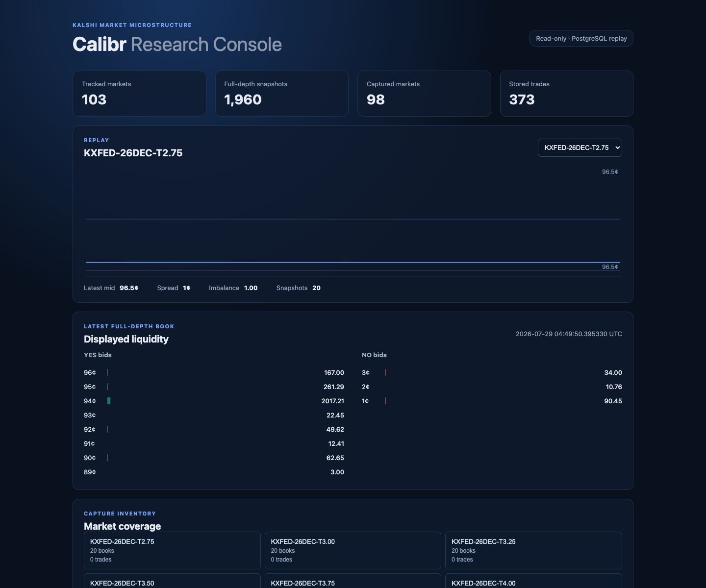

# Calibr

Calibr is a calibration-driven market-making research system for Kalshi binary contracts. It ingests live full-depth order books, stores replay-ready snapshots, estimates fair probabilities, and provides inventory-aware quoting and backtesting components.

The project is deliberately medium-frequency: calibration quality, transparent risk controls, and conservative backtests matter more than low-latency execution.

## What works today

- Public Kalshi REST connectivity through the current external API host.
- Dollar and fixed-point API responses normalized to exact 1/10,000-dollar price ticks and `Decimal` quantities.
- Full-depth orderbook capture through Kalshi's batch endpoint, stored losslessly in Postgres JSONB.
- Bounded (`--once`) and continuous polling ingestion modes.
- Calibration, fair-value, and inventory-aware quoting modules with unit tests.

Live verification on 2026-07-16 captured full books for all 98 tracked KXFED markets. The local database contained 3,136 snapshots, including 98 full-depth snapshots.

## Quick start

Install dependencies in a Python 3.11+ environment:

```powershell
pip install -r requirements.txt
```

Start local Postgres with Docker Desktop:

```powershell
docker compose up -d postgres
python -m db.db
```

Run one bounded, full-depth ingestion pass and inspect validated coverage:

```powershell
python -m data.ingest --series-ticker KXFED --once --verbose
python -m data.verify_ingestion --series-ticker KXFED
```

For continuous polling, omit `--once`; stop the loop with `Ctrl+C`. The coverage command reports valid full-book payloads, invalid raw payloads, and the number of tracked markets still missing a valid full book.

For a reproducible multi-pass capture window, use `--passes` rather than stopping manually. This example collects 30 passes at 10-second intervals, then exits:

```powershell
python -m data.ingest --series-ticker KXFED --interval 10 --passes 30 --verbose
python -m data.verify_ingestion --series-ticker KXFED
```

Price fields use integer ticks throughout the pipeline: `10,000` ticks equals
`$1.00` and `100` ticks equals `1¢`. This preserves Kalshi's four-decimal
prices (for example, `$0.0760` is `760` ticks) without floating-point rounding.

To capture contemporaneous trade evidence alongside order books, add
`--capture-trades`:

```powershell
python -m data.ingest --series-ticker KXFED --interval 10 --passes 360 --capture-trades --verbose
```

## Key paths

- `data/kalshi_client.py` — public REST client and API normalization.
- `data/ingest.py` — full-depth polling ingestion.
- `data/backfill.py` — resolved-market and trade backfill.
- `data/verify_ingestion.py` — database coverage report.
- `models/` — calibration metrics and fair-value models.
- `quoting/` — inventory-aware quote and risk logic.
- `backtest/replay.py` — deterministic full-depth replay and microstructure features.
- `backtest/simulator.py` — conservative order/fill lifecycle and accounting primitives.
- `backtest/simulation.py` — event-driven replay/trade/order integration with an auditable trace.
- `backtest/engine.py` — legacy backtest scaffold to migrate onto the simulator path.
- `dashboard/` — local React dashboard and read-only Python API for capture/replay inspection.
- `.spec/` — durable project and agent context.

## Local Dashboard

The dashboard makes the stored market-data pipeline visible: capture coverage,
replayed midpoint/spread, displayed liquidity, and per-market snapshot/trade
counts. It is intentionally read-only and uses the same Postgres/replay path
as the research components.

With Postgres running and the dependencies installed, launch both the API and
React client with one command:

```sh
./scripts/run_dashboard.sh
```

Open the URL printed by the script (normally `http://127.0.0.1:5173`). Press
`Ctrl-C` to stop both processes. If either normal port is occupied, the script
selects the next available port automatically.

For first-time JavaScript setup only:

```sh
cd dashboard/web && npm install
```

To request specific ports, set `CALIBR_API_PORT` and/or `CALIBR_WEB_PORT`
before running the launcher.



## Roadmap

1. Backfill resolved KXFED markets and trades for a labelled training set.
2. Build a replay reader over stored full-depth snapshots.
3. Evaluate a naïve mid-price baseline with Brier score and reliability diagrams.
4. Train a calibrated fair-value model and compare it with the market mid.
5. Backtest inventory-aware quotes against conservative fill assumptions.

See [.spec/STEERING.md](.spec/STEERING.md) for the design and [.spec/PROJECT_CONTEXT.md](.spec/PROJECT_CONTEXT.md) for current implementation status.
